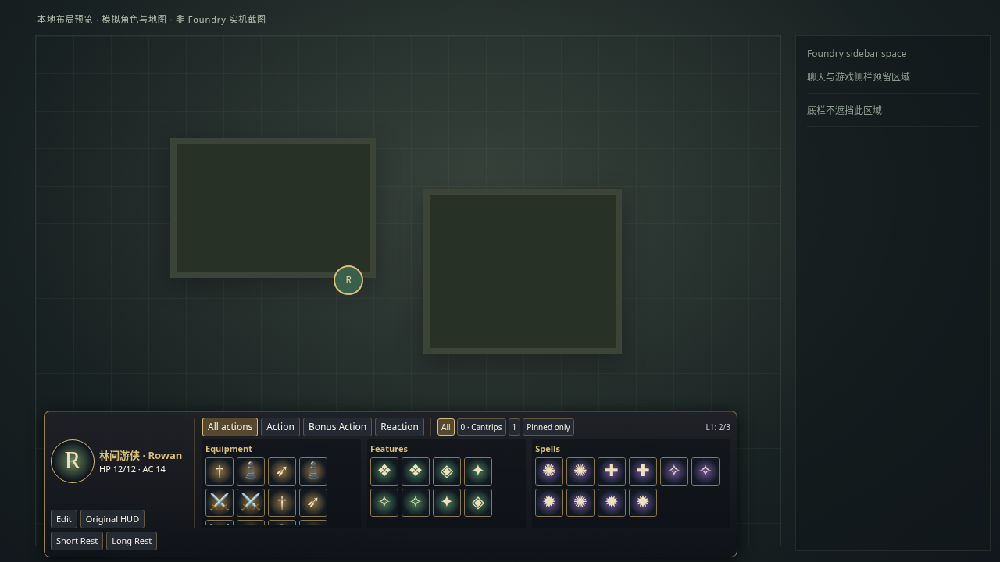

# 720P 紧凑底栏

这次修订解决文字列表导致 HUD 占据接近半屏的问题。角色头像／HP／AC 放在左侧；装备、能力、法术使用图标格；动作筛选、法术等级及法术槽放在同一条顶部工具栏。每个分组独立滚动，物品数量不会增加面板高度。

- 正常模式：图标为主，完整物品名、等级及使用次数保留在原生悬停提示和可访问名称中；缺少图片时显示名称首字。有限使用次数另显示角标。
- 编辑模式：显示物品名和隐藏／固定／排序按钮，保留拖动与键盘排序；底栏高度不变，内容按需滚动，仍禁止使用物品。
- 同一角色更新时保留各组滚动位置，切换角色时回到顶部。角色／用户布局存储格式、官方物品使用与休息流程不变。
- 桌面布局预留 Foundry 左侧控件和右侧边栏的空间；窄屏改用两行筛选，不堆叠三张长列表。

## 本地测量

以下均是 Chromium 的 CSS 视口／模拟角色测量，**不是 Foundry 实机验收**。

| 视口 | 常态底栏高度 |
| --- | --- |
| 1280×720 | 188px |
| 1366×720 | 188px |
| 1280×600 | 180px |
| 1920×1080 | 204px |
| 390×844 | 238px，双行筛选 |

1280×720 下，同一组模拟角色旧布局实测 386px，新布局 188px，减少 198px，约 51%。此对比只衡量屏幕占用，不声称已与参考视频逐帧一致。上传视频超过当前文件工具的 32MiB 读取上限，未能检查其具体动效及细节；本次依据用户实机截图和小屏高度问题实现。

## 已执行检查

171 项自动化检查通过：63 Node、44 共享实例部署／配置、22 离线安装、42 Chromium DOM／输入检查。另通过语法、清单、打包、SHA-256 和 Playwright 用例发现检查。

布局检查覆盖 390×844、650×900、1024×576（720P 的 125% 缩放等效 CSS 视口）、1024×600、1280×600、1280×720、1366×720、1440×900、1920×1080。测试验证控件位于视口内、每组至少一个完整格可见、180 件物品不会撑高底栏、真实滚轮可滚动每组、末项能获得焦点并命中、刷新保留滚动位置、九级法术筛选可键盘访问、编辑模式与返回原 HUD 可用。

本地预览：在仓库根目录启动 `python3 -m http.server 8765 --bind 127.0.0.1`，打开 `http://127.0.0.1:8765/tests/compact-preview.html`。预览只含原创模拟图标／地图与测试数据，不连接 Foundry，不保存玩家或世界数据。

## 未执行与发布边界

尚未在现有 ModsTest 中安装这次 UI 修订。真实 Foundry 主题 CSS、系统弹窗、所有边栏展开状态、浏览器缩放和真实物品图标仍需按 [人工验收清单](MANUAL_TESTS.md) 复核。服务器文档读取阻挡见 [实机报告](MODSTEST_LIVE_REPORT.md)，不能把浏览器 fixture 通过写成实机通过。

本次不发布 GitHub Release、不部署服务器、不重启 Foundry、不修改世界或模组启用状态。现有已安装版本不会因合并代码而改变，自动部署继续关闭。
