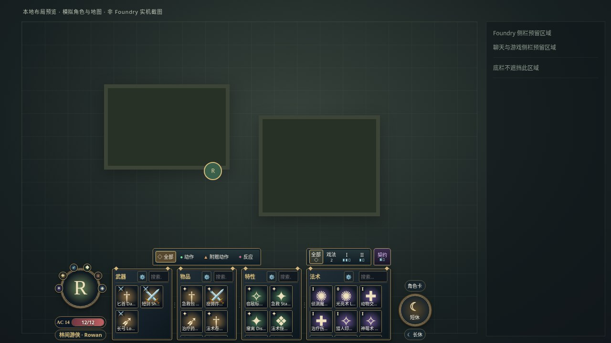
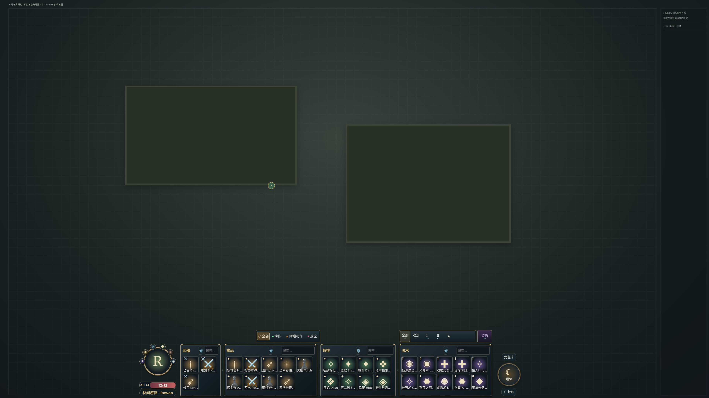
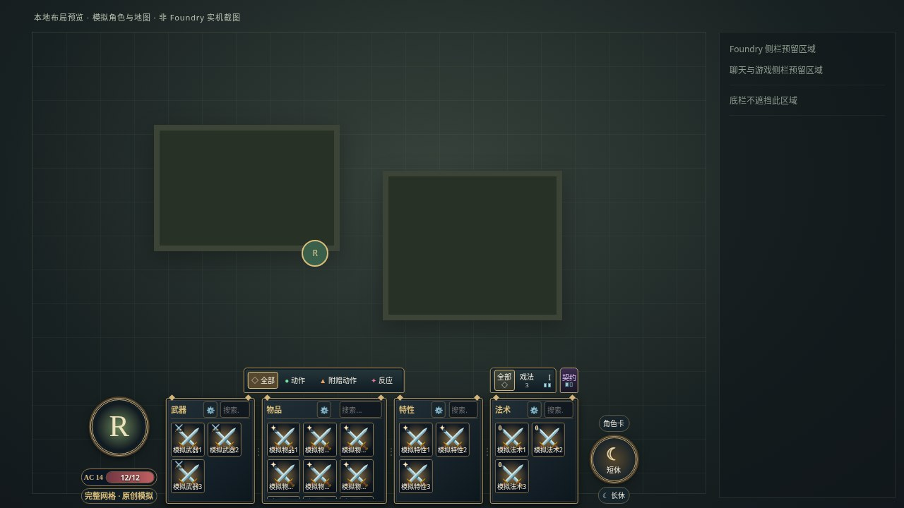
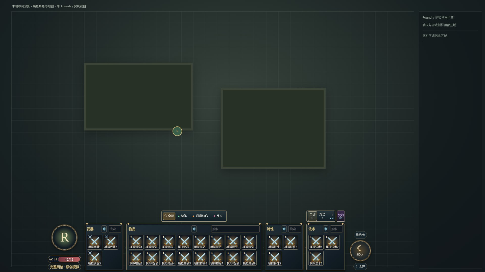
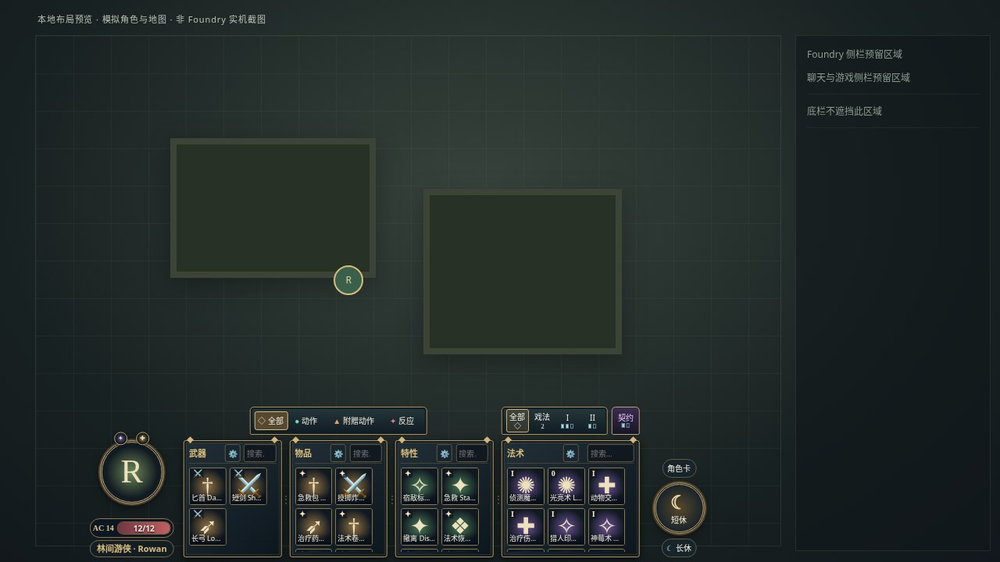
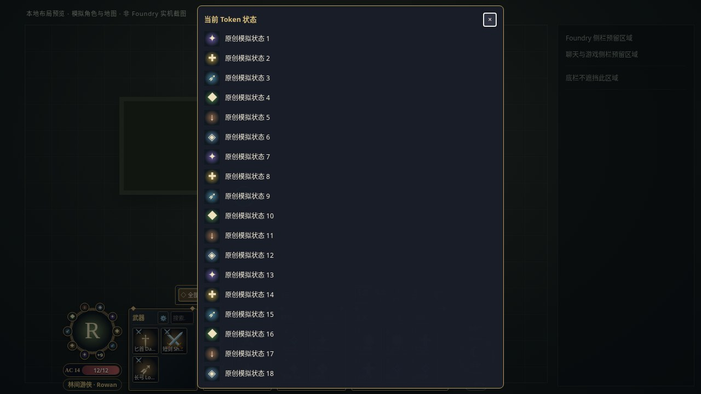
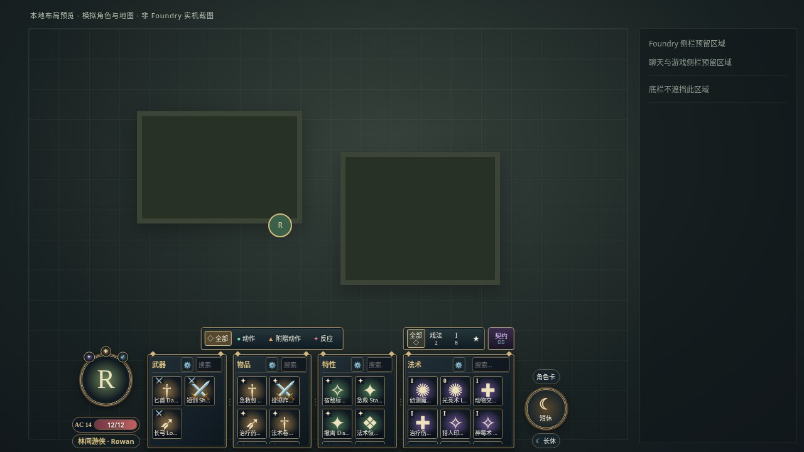

# 720P～4K 自适应参考布局（v0.1.18）

本版按原作者实际底栏结构独立重做：圆形头像／AC 和生命胶囊、按数量分配宽度的武器／物品／特性／法术四块金边栏、悬浮资源条、右侧圆形操作组。整体宽度按视口有界缩放并居中，测量实际侧栏避让；同一视口下不受角色能力数量影响。默认自动分配，手动比例可拖动／键盘调整并按用户、角色保存；不是固定为某个物理分辨率。

按有效 CSS 视口同时限制宽、高、图标、头像、字号和间距；原始 720P～4K 可以显示两排技能。图标按视口基准有界缩放（基准约 32～90px，实际尺寸为填满整列而向下微调），基础字号 11～22px，有上下限。更多物品在各栏内部滚动，不继续增加 HUD 高度。底部名称、环阶／余量保留在格子上；有图标时隐藏图标背后的大字占位，图片失败恢复文字回退。格子固定为正方形，图片等比放入，完整名称及说明可以悬停或键盘查看。

分组齿轮在独立弹窗中管理显示与排序；活动、施法方式、来源和手动目标分配也在弹窗。原底部操作条及更多菜单已完全移除，显示与排序由各分类原有齿轮编辑。确认内容不挤占技能栏。

按未隐藏且符合主动规则的条目数计算，数量不足3的栏至少留一列，数量≥3的栏至少保留两列实际图标；优先把整列空间给每列承载条目最多的分类，所有宽度都转成完整图标列，并统一微调正方形图标尺寸以填满。空间不足保留滚动，数量少或为空也不缩小整体；边框／内距／滚动条单独预留，总宽预算始终用满，允许完整空图标位置，不留装不下一列的尾部空条。搜索、动作和法术等级筛选不触发数量重算；物品增删、隐藏设置、角色切换和视口变化会重新分配。

旧三栏／四栏 ratios 仍保留在原用户数据中，但默认不覆盖新版自动分配，不自动迁移写入。新拖动／方向键操作会显式记录 columnSizing=manual；双击／Home 删除此手动模式和比例，恢复自动。没有角色或 GM 未选择时不强制显示空角色栏。

## 本地实际测量

总宽度由视口和侧栏决定，下表是本次模拟数据的近似值；相同条件下切换角色或改变数量不会改变总宽。以下为原创模拟角色，带 250px 模拟侧栏，DPR=1 的 CSS px。不是 Foundry 实机或显示器认证。图标宽度随分栏可用空间变化，表中列出高度。

| CSS 视口 | HUD 宽×高 | 图标高 | 基础字号 | 预览 |
| --- | --- | --- | --- | --- |
| 1280×720 | 793×193 | 48 | 12.0 | [预览](images/responsive-1280x720.jpg) |
| 1366×768 | 859×199 | 48 | 12.4 | [预览](images/responsive-1366x768.jpg) |
| 1920×1080 | 1284×236 | 59 | 14.7 | [预览](images/responsive-1920x1080.jpg) |
| 2560×1440 | 1624×280 | 68 | 17.4 | [预览](images/responsive-2560x1440.jpg) |
| 3840×2160 | 2072×357 | 87 | 22.0 | [预览](images/responsive-3840x2160.jpg) |

720P 的默认外框高约 193px，约占27%；其透明部分不会遮成一整块实心面板。4K 约357px，占17%，更大视口停止放大。旧版188px布局不是本版的固定目标；这次使用接近原版的两排有名称技能格。很矮的缩放后视口优先留下地图，通过分组滚动访问更多格子。





## 缩放、DPI 与验证边界

离线 Chromium 使用五种原始视口×100%／125%／150%／200%等效 CSS 视口及对应模拟 DPR；另有九种窄屏／低高度／超宽组合。1280×720 的200%等效视口为640×360。相同CSS视口单独改变DPR不再重复放大HUD。

测试实际几何：完整首格、原始视口的两排格子、可达按钮、字号及尺寸边界；真实滚轮访问180件模拟物品；九环筛选及焦点保持；真实鼠标拖动分隔线、方向键调整、Esc撤销、侧栏宽度变化、弹窗键盘操作和返回原版。分隔线保存只发生在确认调整时，普通缩放不写布局。

模拟不能代替操作系统DPI、浏览器工具栏、跨显示器拖动或第三方主题的实机验收。侧栏只测量Foundry的`#sidebar`，不推测任意第三方浮窗。实际主题／模块组合由用户手动验证；自动实机测试保持停止。

复现：

```sh
npm run test:browser
CHROMIUM_PATH=/path/to/chromium node e2e/capture-previews.mjs
```

预览输出含五档截图、施法／来源／编辑／说明／分配弹窗截图和测量JSON。全部原创模拟数据，不登录Foundry。完整检查结果见[测试报告](TEST_REPORT.md)，参考差异和第三方规则边界见[原作者对照](PROTOTYPE_COMPARISON.md)。

自动模式下，窄侧栏预算不足以容纳所有最低列数时，各栏的图标可在自身正方形格子内有界缩小以维持最低两列；不扩大或缩小 HUD 总宽。


## 固定总宽内铺满网格的回归预览

使用原创模拟数据复现3武器／16主动物品／3主动特性／3法术的数量组合；不是用户世界截图。每栏完整轨道铺满，剩余容量为完整空位；边框、内距和稳定滚动槽仍保留。






## 头像顶部相邻状态

头像周围最多显示10项，按36度相邻间距组成连续弧线，以头像顶部中线为中心整组对称排列。两个状态分居中线左右且同高，三个状态的中间项正对头顶；前5项均位于上半圈。新增／移除状态后整组重新居中，取代v0.1.16的旧位置不动规则。来自当前所选Token的actor（包括未链接Token的合成Actor），不是按ID查询世界角色。读取原生temporaryEffects和actor.statuses，合并同一状态；停用／抑制效果排除，普通无状态的永久被动效果不从备用集合带入。图标和原生状态配置支持名称本地化，图片缺失／失败保留问号及完整名称。Token叠加状态也只读显示。

超过10项时显示前9项和+N按钮，展开当时的全部状态列表；不修改效果、持续时间、角色或Token文档。原有ActiveEffect／Token hooks刷新状态环，切换Token即重新读取并关闭旧弹窗。

底部不再保留常驻操作条或空白行。更多按钮、弹窗及原次要操作入口已移除，不迁移到新菜单；分组齿轮继续可用。取消选目标／停止后续按钮和反馈按需悬浮，不占用常驻底栏高度。







## 独立契约法术位

法术筛选右侧的紫色小面板在“契约”下显示与普通法术位相同的方格，亮格可用、空格已消耗，与普通环阶按钮和普通位分开；Tab聚焦或悬停可读契约环级、当前/总数及完整只读说明。读取当前Actor原生 `system.spells.pact.value/max/level`，原生资源事件和Token切换会刷新。耗尽时保留所有空格；缺失或0/0时隐藏。当前数未知时使用虚线格，总数未知时显示?，完整原生数量始终保留在title和ARIA中，不猜测或自行扣资源。与普通位一样最多画12格，窄面板可换行。契约位本身不会增加普通环阶，实际已知法术仍按自身环级参与筛选。

契约位存在时，自动布局给法术栏至少两列的头部预算，避免“很多物品／只有一个法术”挤掉筛选；不伪造能力数量，不改变总宽或统一方格算法。手动比例仍由用户控制。


