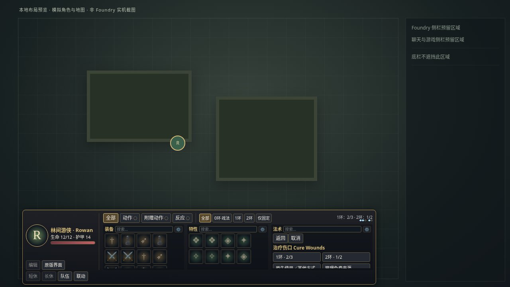
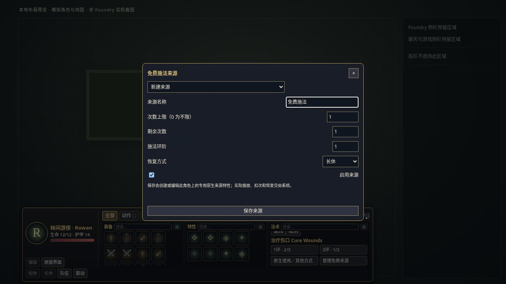
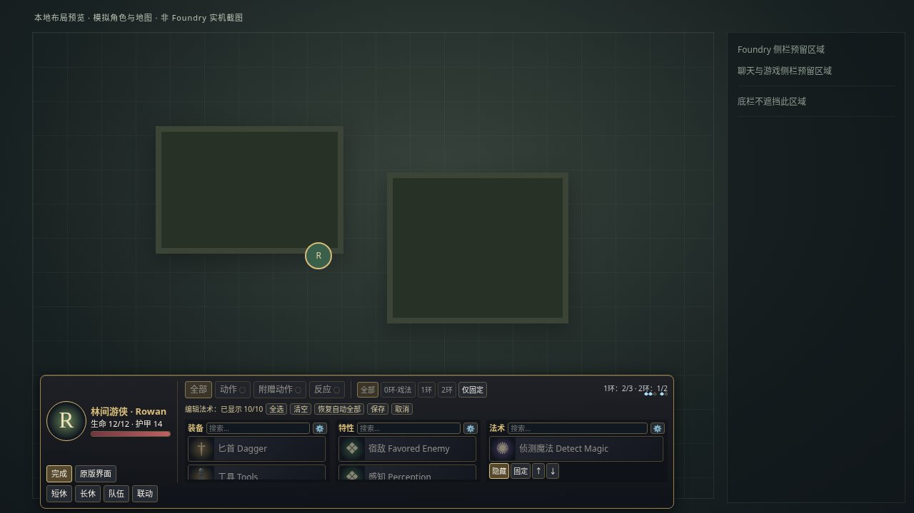
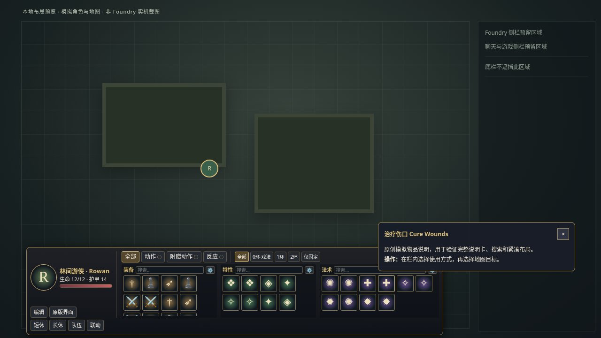

# 视频功能补齐与操作

本轮代码尚未发布。稳定安装地址目前仍为 v0.1.1；本页与截图描述开发版本。截图全部使用原创模拟角色、图标和地图，**不是 Foundry 实机验收截图**。

## 攻击与施法

1. 点击图标，在原分类栏选择原生活动，再选择法术位、已有来源或“使用并结算”。“返回”“取消”均可退出尚未开始的操作。法术环阶筛选只筛列表；施放卡片才选择本次法术位。
2. 单体点地图目标即进入原生流程，无额外 HUD 确认。多目标拖出选区，自动选择其中可见 token 的中心。真正的圆、锥、线等范围技能沿用系统 Region 模板。
3. 普通单体攻击会顺序请求原生攻击与伤害掷骰。灼热射线及魔能爆使用系统稳定 identifier 的明确配置：先调用一次原生施放，再逐条执行原生攻击／伤害，保留暴击和原生取消；已知原生命中失败或大失败不请求伤害。伤害应用仍使用系统聊天卡。
4. 多射线默认在框中的目标之间轮流分配，允许只有一个目标时全部指向它。勾选“手动分配／撤回”可在框选后给同一目标多次分配，用加减或“撤回一次”调整，选满后确认。默认仍是用户要求的范围自动选择。
5. 原生窗口改变升环时，按系统最终活动重新计算标准射线数；必要时再次分配。自定义重复次数限定 1～20，不从名字、描述或任意多目标数推测规则。非标准多次攻击、魔法飞弹的共享伤害规则等应使用原生流程，或明确配置自定义次数并自行核实规则。
6. 连续结算中可点“停止后续”。当前原生窗口仍需自行取消。出错或中止不会重新施放、补扣资源或自动退款。停止位置会保留以便核对聊天卡。

**消耗边界：**消耗、弹药、专注、聊天与模板由 D&D5e 原生接口处理。HUD 不减法术位、不改目标 HP。取消 HUD 的初始目标选择不会使用技能；原生施放／模板阶段可能已消耗资源，不能承诺退款。Midi-QOL 启用时不启动本界面连续结算，选择“原生使用／其他方式”交回原生自动化，避免重复掷骰。

## 免费来源

在法术的施放面板选择“管理免费来源”，填写名称、上限、剩余次数、施法环阶与恢复方式。上限 0 表示不限次数，可选择短休、长休、每日或不自动恢复。

只有点击“保存来源”才在当前拥有的角色上创建一个带本模组标记的**原生特性物品**和 cast 活动。再次打开可编辑或停用该来源；只编辑本模组管理的字段，保留其他字段，不修改原法术的准备状态。停用约束本 HUD，不篡改系统角色卡的功能。

施放时使用原生关联来源和原生消耗处理：免费来源替代个人法术位／原活动的个人次数，保留材料或其他独立资源成本；来源次数和休息恢复由系统负责。来源不是绕过 DM 规则的授权，普通玩家仍需原生文档创建／更新权限。实际次数、恢复和升环组合还需实机核验。

## 搜索、说明与编辑

- 装备／特性／法术分别按名称搜索，支持中文输入法。搜索和重绘保持焦点、光标及独立滚动。
- 悬停或键盘聚焦物品显示完整名称及原生富文本说明；接口不可用时显示物品描述。过滤脚本、事件属性与危险链接；不展示原生 secret 内容。
- 点击分类齿轮编辑该分类，或“编辑”管理全部。逐项显隐、固定、箭头和拖动先进入草稿；“全选／清空”作用于当前分类搜索结果，“恢复自动全部”恢复该分类自动显示和排序。
- “保存”或“完成”只写当前用户自己的布局叶节点；“取消”丢弃整次草稿。检测到其他窗口更改布局时拒绝旧草稿覆盖。此检查不是跨客户端原子锁；同时提交仍采用原有后写生效语义。

## 状态与联动

- 生命条含临时生命提示；普通／契约法术位同时显示数字与剩余标记。
- 选目标时显示技能图标、连线、分配编号及基础命中率／平均伤害估算。没有目标 OBSERVER 权限不显示其生命、护甲或基于护甲的命中率。无法解释的公式显示未知，不执行任意公式代码。
- 估算包含可读的原生优势／劣势修正、基础距离与视线提示；不等于完整合法目标、抗性、掩护、临时加值或自动化判定。实际结算以系统为准。
- 动作／附赠动作／反应保留筛选，同时标记本客户端在当前战斗回合位置观察到的原生活动使用次数。这是使用记录，**不是权威剩余动作**；不禁止额外动作，也不把未记录当作尚未消耗。刷新客户端会清空记录。
- “队伍”查看已分配且有权限的角色生命、护甲和被动察觉；只有有权限且在当前场景可见的 token 才能被选择。地图悬停提供受权限限制的浮动状态。
- “联动”显示 Dice So Nice、Automated Animations、Sequencer、Midi-QOL 的启用状态。原生掷骰／聊天钩子交给已安装模组；不重复请求 3D 骰子、不自动安装或启用第三方模组。未启用 Automated Animations 时提供本扩展的轻量投射／目标反馈，支持减少动态效果设置。这不等于复刻视频的特定素材或完成第三方组合验收。

底栏继续按 CSS 可用视口在 720P～4K 流式缩放。新增面板使用内部滚动，不增加 720P 的 188px 基础底栏高度。工具栏、DPI、真实浏览器缩放和实机侧栏仍按[自适应说明](COMPACT_HUD.md)区分证据。

## 验证状态

本轮 254 项离线检查通过：97 Node、44 共享实例／配置、22 安装、91 Chromium。覆盖一次原生消耗、多射线／暴击／取消／最终升环、攻击模式／弹药参数传递、权限撤销、错误位置、草稿排序／取消、来源管理、隐私、说明卡安全及跨分辨率输入。

真实 Foundry 文档 RPC 的既有阻塞仍未解决，**尚未通过 Foundry HUD 实机验收**。本轮未登录线上、发布 Release、部署文件、启用自动部署或重启服务。实机清单见 [MANUAL_TESTS.md](MANUAL_TESTS.md)，诊断记录见[实机报告](MODSTEST_LIVE_REPORT.md)。
