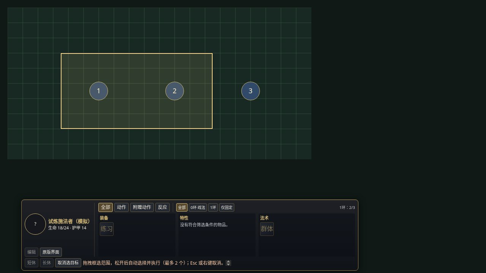

# 地图目标选择（尚未发布）

本轮已读取用户提供的三个小于 32MiB 的视频片段，参考其交互，再采用用户明确的新要求：**单体点选执行，多目标使用范围选择，自动选中范围内 token**。原始片段和分析帧未提交，也不进入安装包。

## 操作

1. 选择自己拥有权限的角色，点击装备、特性或法术。多个可用活动时，先使用系统的活动选择窗口；取消窗口不使用技能。
2. 单体技能：点击地图目标进入系统使用流程。点空处或拖动不会执行；点选过程不会把操作者切换成被点击的角色。
3. 普通多目标：地图进入十字光标模式，拖拽出矩形选区。松开后自动选取中心落在选区内的可见 token，并进入系统使用流程。超过活动当前已准备的人数上限或没有目标时，显示原因并等待重新框选；不静默截断列表。
4. 原生面积技能：继续使用 D&D5e 的 Region 模板放置。放置完成后，按原生 Region 的几何与高度检查，自动选择其中可见 token 的中心；保留系统创建的模板，不另建第二张模板。
5. HUD 点选／框选中可用 Esc、右键或底栏“取消选目标”退出。拖动中失去焦点、滚轮导航、窗口尺寸变化、切换角色／操作者 token、场景拆卸或关闭 HUD 会清理本模组的监听器、光标与选区。原生流程开始后使用其自己的取消控件；HUD 不强制关闭系统弹窗。若此时换角色／场景，本次标记的完成守卫会阻止后续自动动作，并在原生流程结束后移除；不会把旧技能重定向给新角色，也不声称回滚已发生的消耗。

底栏提示与取消按钮不改变 HUD 固定高度。编辑、休息与其他技能在同一 HUD 流程进行期间暂停，避免同时发起两个使用流程。选区仅是选目标工具，不代表增益法术实际拥有矩形伤害范围。

## 目标与系统边界

- 自动选择仅包含当前场景／楼层、有角色且当前可见、可渲染、非隐藏的 token。没有额外权限读取迷雾或隐藏目标；即使 GM 也不自动包含标记为隐藏的 token。目标可以包含自己或队友；这里不凭阵营猜测应当攻击谁。
- 中心位于边界上时计入，只有图像边缘相交不会计入。鼠标坐标先换算 Canvas CSS 尺寸与场景平移／缩放，DPR 不重复相乘。
- 使用准备后的活动目标人数；不根据物品名字或描述推算法则，不自行执行目标人数公式。升环选择保留系统窗口；本次普通框选人数取选择开始时的已准备活动值，不在升环窗口后再扩大框选。未识别的自定义目标配置交回原生流程。
- 原生使用可能仍弹出施法、消耗、优势／劣势或掷骰确认窗口。“点选执行”指无需第二个 **HUD** 确认，不等于绕过系统确认。
- 自选目标会像 Foundry 目标工具一样保留为当前用户的目标。不能在 `activity.use()` 返回后立即恢复旧目标：6.0.6 的后续攻击／掷骰并非全部由其返回 Promise 等待，过早恢复会把原生掷骰指向旧目标。
- 原生区域技能的资源消耗可能发生在模板放置之前。取消本 HUD 尚未交出的点选／框选不会调用使用接口；原生阶段的取消／退款遵循系统，不能宣称所有取消都零消耗。
- 原生 Region 完成后仅通过本次使用标记匹配的钩子更新目标，以及本次已有的聊天卡目标列表。不会补开技能、补扣法术位、重试使用、自动改敌人 HP 或绕过专注流程。最后一次使用导致物品删除／重准备也不会误把本次合法的区域选取丢弃。
- 多射线在此界面中采用用户要求的范围选取 **不重复的 token 集合**；没有复刻视频中重复点击同一 token 的逐射线分配、命中率估算、免费施法来源编辑、法术准备编辑或第三方动画。具体射线数量、攻击／伤害结算及自动化模组兼容性仍须原生／实机核验，不能把选中了多个目标当作已经结算了全部射线。

## 离线模拟预览

此图为真实 HUD／选择控制器在 Chromium 中的模拟数据截图，编号圆形与网格为原创测试图形；不是范例视频截帧，也不是 Foundry 实机验收证据。

## 自动检查与尚待实机验证

当前共 220 项：77 Node、44 共享实例／配置、22 离线安装、77 Chromium DOM／输入检查。新增覆盖单体／多人／无限目标分类、原生区域唯一调用和钩子清理、最后一次消耗、活动选择取消／权限变化、反向拖拽、空／超量选区、隐藏／楼层／场景隔离、变更角色／删除物品／取消流程，以及真实 CDP 鼠标点选、指针捕获、Esc 和 200% 等效 720P／DPR 2／CSS 缩放后的坐标。原有中文化、滚动、编辑／排序和 720P～4K 几何回归继续通过。

这些是使用真实运行时代码、模拟文档／系统回调的离线检查。尚未在持有许可证的 Foundry V14／D&D5e 6.0.6 实例验收 Region 放置顺序、真实原生弹窗、资源消耗、聊天卡和多客户端行为；原有 ModsTest 读取阻塞并未因本轮界面测试消失。正式标记通过前，应在 ModsTest 完成以下项目并恢复专用测试角色数据：

- [ ] Gamemaster、Player1 分别验证单体武器／戏法／有环法术、多活动选择与取消；每个只调用一次原生流程。
- [ ] 增益多目标框选含自己、不同人数、空区和超量；普通／契约法术位、升环后的目标数量与系统卡一致。
- [ ] 圆／锥／线等原生 Region 放置、旋转、高度／楼层、隐藏／迷雾目标、取消、聊天卡及下一次掷骰的实际目标。
- [ ] 多射线、多次攻击、专注／范围模板、限次物品最后一次使用，以及已安装的自动化模组组合；分别核实结算与选中集合。
- [ ] 拖拽越出画布、右键／Esc、切换操作者／场景、权限撤销、失去焦点和窗口缩放后没有悬挂输入或错误使用。

中文和此选目标功能尚未进入新 Release；当前稳定安装地址仍是 v0.1.1。本轮未登录、部署、重启或修改线上 Foundry，也未启用自动部署。
